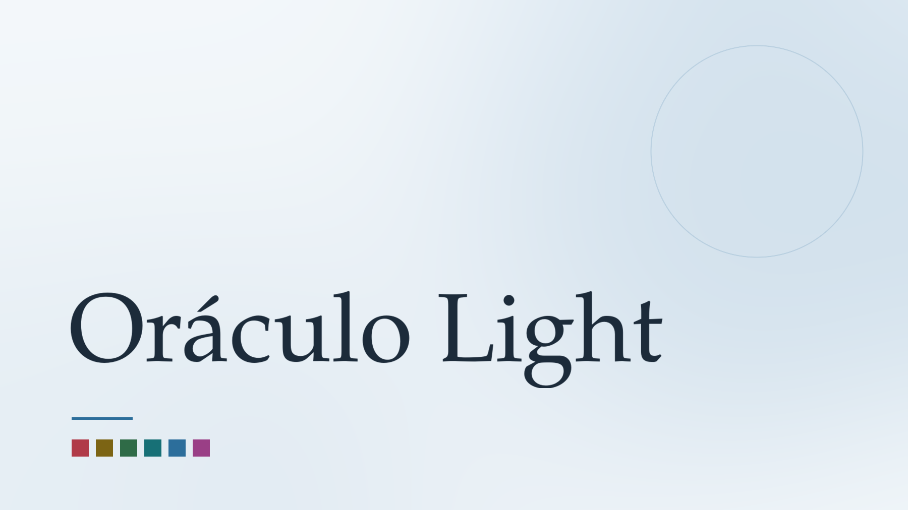

# Oráculo Light

A **light** Omarchy theme in the Oráculo family: cool paper surfaces tinted
sky, deep steel-blue ink, and a darkened steel accent that stays readable on
paper. The bright sibling of
[Oráculo (dark)](https://github.com/PedroAugustoOK/omarchy-oraculo-theme).



## Palette

Every generated config — Hyprland borders, the shell (bar, menus, launcher,
notifications, OSD, lock screen), Alacritty/Foot/Ghostty/Kitty, btop,
Chromium, Neovim, Helix, VS Code, Obsidian, Claude/Pi/Hermes/T3Code, tmux,
GNOME and the keyboard backlight — derives from `colors.toml` through
Omarchy's built-in templates.

| Key | Value | Role | Contrast on background |
|---|---|---|---|
| `mode` | `light` | cool paper surfaces, dark text | — |
| `background` | `#F3F7FA` | primary paper, ANSI 0 | — |
| `foreground` | `#1C2B3A` | deep steel ink, ANSI 7 | **13.39:1** |
| `accent` / `blue` | `#2C6E9B` | one accent, darkened steel, ANSI 4 | **5.12:1** |
| `selection` | `#D7E5F1` | selected-text fill | 1.19:1 (fill) |
| `muted` | `#9FB2C4` | soft borders and placeholders, ANSI 8 | 2.02:1 (chrome) |
| `dark_foreground` | `#5E7389` | chrome text | **4.55:1** |
| `light_foreground` | `#334A60` | emphasised text | **8.52:1** |
| `bright_foreground` | `#1C2B3A` | cursor, ANSI 15 | **13.39:1** |

Full ANSI set (all measured against `background #F3F7FA`):

- `red #B03A48` 5.50:1, `yellow #7C6414` 5.28:1, `orange #A3562C` 4.97:1
- `green #2F6B47` 5.88:1, `cyan #177076` 5.39:1, `magenta #9A3F86` 5.69:1
- `brown #6B4630` 7.66:1
- bright variants: `bright_red #C24550` 4.58:1, `bright_yellow #876F1B` 4.51:1,
  `bright_green #387A52` 4.79:1, `bright_cyan #1C7C82` 4.58:1,
  `bright_blue #2F76A8` 4.56:1, `bright_magenta #A94D95` 4.66:1

The base ANSI floor is **4.97:1** (orange); the bright floor is **4.51:1**
(yellow). Every ANSI entry, base and bright, clears 4.5:1 on the paper.
Selected text (`foreground` on `selection`) keeps **11.24:1**; the
`dark_foreground` chrome role sits at 4.55:1, and `muted` is deliberately a
low-contrast hairline colour, like the official light themes.

Window borders use a steel-blue gradient:

```toml
hyprland_active_border = "rgba(2C6E9Bee) rgba(174A6Dee) 45deg"
hyprland_inactive_border = "rgba(9FB2C4aa)"
```

## Wallpapers

Three 2560×1440 abstract wallpapers in `backgrounds/` (cycle with
`Super + Ctrl + Space`). The light counterpart to the dark set: soft sky
washes on cool paper, no imagery, in the same quiet, blurred language as
[Veredas](https://github.com/PedroAugustoOK/omarchy-veredas-theme).

| Wallpaper | Description |
|---|---|
|  `001-oraculo-light-mist.png` | Morning haze on cool paper, with sky in the corners |
|  `002-oraculo-light-linen.png` | A pale blue halo, barely there |
|  `003-oraculo-light-haze.png` | A slow diagonal sky wash, low and off-centre |

PNG, 54–72 KB each. Original abstract artwork generated programmatically with
ImageMagick; no third-party imagery. Nothing animated.

## Installation

```bash
omarchy theme install https://github.com/PedroAugustoOK/omarchy-oraculo-light-theme
```

This clones to `~/.config/omarchy/themes/oraculo-light` and applies it
immediately (menu path: `Install > Style > Theme`).

## Activation

```bash
omarchy theme list            # confirm `Oraculo Light` is listed
omarchy theme set oraculo-light
omarchy theme current         # should print `Oraculo Light`
omarchy theme bg next         # cycle the three wallpapers
```

Omarchy derives the display name from the repository slug, so the menu and
`omarchy theme current` show **Oraculo Light** without the accent.

Preview the palette without applying:

```bash
omarchy dev theme-preview oraculo-light
```

## Update and removal

```bash
omarchy theme update                # pull latest for all git-installed themes
omarchy theme refresh               # re-apply the current theme after an Omarchy upgrade
omarchy theme remove oraculo-light  # delete the local clone
```

After an `omarchy update`, run `omarchy theme refresh` once so staged configs
are regenerated with the current templates.

To switch to the dark sibling: `omarchy theme set oraculo`.

## Lock / boot art

`unlock.png` and `preview-unlock.png` are generated from `colors.toml` by
`scripts/make-unlock.sh`. The mark is the exact geometric twin of the dark
sibling's Oráculo sigil: three concentric rings broken by a single 45-degree
cut, with a solid centre. Only the palette differs — the forms are the
darkened steel accent on paper, and the dark theme's steel glow becomes a soft
blue bloom of the same opacity profile.

The lock preview is 1920×1080 and the transparent art is 1108×523, matching
the geometry used by the stock Omarchy locks.

## Optional extras (machine-local)

- **Plymouth boot screen**:
  `omarchy-plymouth-set-by-theme oraculo-light` (uses this theme's
  `unlock.png` and its background/foreground colours; asks for sudo; revert
  with `omarchy plymouth reset`). The rendered key art
  (`preview-unlock.png`) is 1920×1080.

## Compatibility

- Omarchy **4.x**, tested on `4.0.6-1`.
- Requires the `colors.toml` theme system with `mode`, template expansion and
  `hypr_gradient` support.
- Everything is derived from `colors.toml` through Omarchy's built-in
  templates. The repository ships **no** `.lua`, terminal configs,
  `vscode.json` or symlinks, since those are dropped or regenerated for
  git-installed themes. The theme looks correct from `colors.toml` alone.
- Icons: `Yaru-blue`. Keyboard backlight: darkened steel `2c6e9b`.
- No animated `backgrounds/intros/`; the OWE wallpaper engine is optional and
  this theme stays static.

## Repository structure

```text
omarchy-oraculo-light-theme/
├── colors.toml          # the palette — the only required file
├── backgrounds/         # 3 abstract 2560×1440 wallpapers
├── icons.theme          # Yaru-blue
├── keyboard.rgb         # 2c6e9b
├── preview.png          # 1800×1012 theme-picker artwork
├── unlock.png           # transparent lock/boot art (Oráculo sigil)
├── preview-unlock.png   # 1920×1080 lock/boot styles preview
├── scripts/             # make-preview.sh, make-unlock.sh, make-wallpapers.sh
├── README.md
├── RESEARCH.md          # light-mode conventions and measured contrast
└── LICENSE              # MIT
```

The three scripts are reproducible from `colors.toml` alone. Regenerate the
artwork with:

```bash
./scripts/make-preview.sh . "Oráculo Light" preview.png
./scripts/make-unlock.sh .
./scripts/make-wallpapers.sh .
```

## Credits and license

- Theme, palette, wallpapers and lock art: original work for this repository,
  generated programmatically with ImageMagick. No third-party assets.
- Palette and configuration: MIT (see [LICENSE](LICENSE)).
- Wallpapers and previews: same MIT license (original works).
- Built for [Omarchy](https://omarchy.org) (`basecamp/omarchy`). Icon set names
  belong to Yaru; font rendering in previews uses system fonts.
